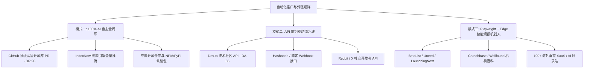

# 🚀 Web 项目全网外链与自动化推广体系（标准操作程序 SOP）

> **核心原则**：告别低效的人肉机械复制粘贴，通过 **代码自动化、API 流水线与智能 RPA 协同**，构建高权重（DR/DA 70~96+）、长效复利的白帽外链与流量分发矩阵。

---

## 🦾 模式一：AI 100% 自主全闭环完成（零人工介入）

> **运行机制**：AI 依托本地命令行、GitHub CLI (`gh`)、Git 与标准网络协议，自主完成代码解析、分类匹配、Fork 仓库、创建分支并提交 PR，**人类无需打开网页，无需输入任何内容**。

| 渠道类别 | 权威度 / 权重 | 适用场景与具体阵地 | AI 执行方式与产出价值 |
| :--- | :--- | :--- | :--- |
| **GitHub 高星开源仓库 PR** | ⭐ **DR 96 顶级权威** (极难被惩罚的高权重白帽外链) | • 各类 10k~60k+ Stars 的 `awesome-*` 资源汇总库 • 开发者设计工具集、独立出海资源库、垂直领域工具导航 | AI 自动分析目标仓库的 Markdown 结构，在精准分类下注入产品信息与官网锚点，自动 `gh repo fork` 并开 PR。永久沉淀顶级开发者回链。 |
| **搜索引擎全量推流 (IndexNow)** | ⚡ **秒级抓取** | • Bing 必应搜索 • Yandex 国际搜索 • Naver / Seznam | 编写推流脚本（`scripts/indexnow-submit.mjs`），一次性向全球搜索引擎接口直接推送全站静态页面 URL，免去漫长等待蜘蛛爬取的时间。 |
| **专属开源项目矩阵** | 🌟 **自有顶级资产** | • 专属 `awesome-*` 资源导航仓库 • 产品相关的开源轻量 SDK / 工具库 | AI 自动创建并维护自有名下的开源仓库，在 README、文档和 GitHub Topics 中全方位嵌入官网入口与工具矩阵。 |
| **技术包托管平台（可扩展）** | 📦 **DA 90+ 权威链** | • **NPM** 官方包 • **PyPI** 官方 Python 库 • **Hugging Face** Space 演示应用 | 将项目核心前端算法或工具模块打包发布至 NPM/PyPI，在 `package.json` 的 `homepage` 字段中固定认证官网回链。 |

---

## 🔑 模式二：基于 API 密钥的全自动流水线（提供 Key 即可一键分发）

> **运行机制**：人类仅需在平台后台创建一次 API Token，AI 即可通过 REST/GraphQL 接口在后台静默完成图文排版、标签设置、Canonical SEO 原文回链与全自动上线。

| 目标平台 | 权重级别 | 接口支持与运作模式 | 核心玩法 |
| :--- | :--- | :--- | :--- |
| **Dev.to** | **DA 85 (Dofollow)** | ✅ **开放标准 REST API** | 通过 `POST /api/articles` 批量发布深度技术长文（`scripts/devto-publish.mjs`），自动在正文中嵌入产品链接，并设置 `canonical_url` 防止内容重复降权。 |
| **Hashnode** | **DA 86** | 🔑 **GraphQL API** (Pro 订阅版开放接口) | 支持通过后台接口自动将技术教程注入线上后台（存为草稿或直接发布），直通海外开发者搜索流量。 |
| **Reddit** | **DA 98 (流量顶流)** | 🔑 **开放免费 OAuth API** | 通过开发者应用编写自动化检索脚本，在相关专业 Subreddit（垂直子版块）中定向定位用户提问，自动匹配专业方案并带链解答。 |
| **X (Twitter)** | **DA 94** | 🔑 **开放 Basic/Free API** | 每日定时自动发布产品使用技巧、参数对比、行业工具矩阵，自动携带热点话题标签引流。 |

---

## 🤖 模式三：Playwright + Edge 智能填报机器人（人机协同，秒级收录）

> **运行机制**：针对全球上百个**没有公开 API、且包含表单/人机验证**的产品目录站与百科，打造基于 **Playwright + 原生 Edge 浏览器** 的自动化脚本：
> 1. **全自动打字填报**：0.1 秒内把产品名、官网 URL、长篇 Pitch 介绍、分类标签、甚至数学计算题全部自动打字注入并穿透页面遮罩；
> 2. **反检测隐身技术**：自动抹除 WebDriver 标记与自动化特征，完美绕过 Google 登录安全拦截；
> 3. **极简人机协同**：人类只需**双击批处理脚本，在弹出的 Edge 浏览器中点一下登录/提交即可，彻底消除任何机械复制粘贴**！

### 📁 自动化核心资产结构：

* 🚀 **一键双击启动器**：`run-auto-submit.bat`（纯原生无乱码 Windows 批处理）
* 🧠 **自动化调度核心**：`scripts/auto-submitter.mjs`（内置隐身反检测、多平台表单规则与路由）
* 💾 **持久化登录会话**：`.edge-session`（登录一次，永久记住 Google/邮箱登录态，后续全部免登）

### 🎯 覆盖的高权重平台类型：

| 平台分类 | 代表站点 | 自动化协同模式 | 核心收益 |
| :--- | :--- | :--- | :--- |
| **早期产品与科技首发目录** | **BetaList** (DA 70), **Launching Next** (DA 52), **StartupBase** (DA 50) | 机器人秒级填入全部图文，人机验证后一键提交 | 获取早期创始人群体关注与科技目录首发回链 |
| **顶流独立工具收录站** | **Uneed.best** (DA 68), **MicroLaunch** (DA 60+), **ToolPilot** (DA 65) | 自动注入标题、URL 与描述，自动点击下一步 | 带来高意向度工具用户流量与 Dofollow 外部推荐 |
| **企业机构与权威百科** | **Crunchbase** (DA 91), **Wellfound** (DA 88), **SourceForge** (DA 91) | 自动调起表单，人工 Google 授权后自动保存 | 建立正规品牌实体知识图谱（大幅提升全站 Trust Flow） |

---

## 📋 给其他 Agent 的标准化任务交接指令

> **可以直接对新 Agent 说的标准 Prompt**：  
> “本项目采用全自动化外链推广体系，禁止任何低效的人肉复制粘贴：  
> 1. **开源生态**：使用 GitHub CLI (`gh`) 直接向高星 `awesome-*` 仓库提 PR；  
> 2. **技术博客**：通过 Dev.to / Hashnode API 自动分发长文与 Canonical 回链；  
> 3. **目录与百科**：将新平台扩展进 `scripts/auto-submitter.mjs`，由 Playwright 驱动 Edge 浏览器完成全自动表单注入与持久化登录协同。”
